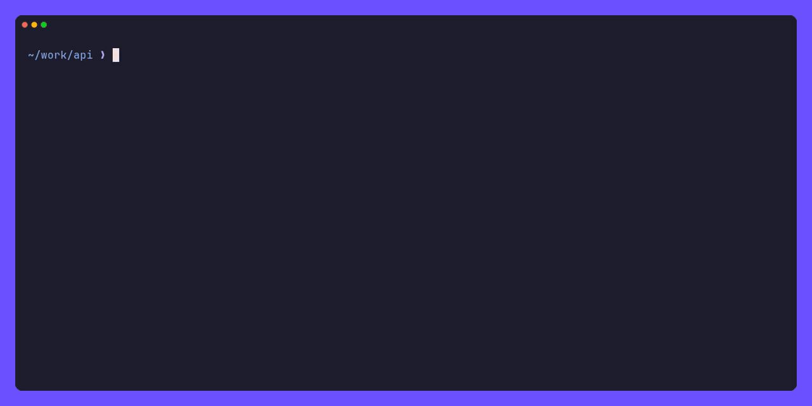

# asq (Agent Session Query)

asq ("ask") finds the coding-agent session you're looking for and resumes it. One picker lists and searches your local sessions from every agent [agentsview](https://github.com/kenn-io/agentsview) knows, including Claude Code, Codex CLI, Cursor CLI, and GitHub Copilot CLI.

Inspired by [recall](https://github.com/zippoxer/recall).



## Install

Download a release binary (macOS arm64):

```sh
gh release download --repo saitota/asq --pattern asq-darwin-arm64.zip
unzip asq-darwin-arm64.zip
install -m 0755 asq ~/.local/bin/asq
```

Or build from source (Go 1.25+):

```sh
go build -o asq ./cmd/asq
```

Requirements:

- Unix/macOS
- [agentsview](https://github.com/kenn-io/agentsview); its daemon starts automatically on first use
- The CLI of each agent whose sessions you want to resume

## Usage

```console
$ asq
> api
  3/14
▌ ●  07-06 18:13  fix-flaky-retry  ~/work/api  main          │ claude 0199a1b2-c3d4-4e5f-8a6b-7c8d9e0f1a2b
  ●  07-05 09:42  auth-refactor    ~/work/api  feature/auth  │ name: fix-flaky-retry
  ●  07-02 11:37  rate-limiter     ~/work/api  main          │ cwd: /Users/you/work/api
                                                             │ branch: main
                                                             │ updated: 07-06 18:13
                                                             │
                                                             │ [1] user 07-06 17:58
                                                             │ the retry test fails on CI but passes
                                                             │ locally, can you take a look?
```

A session matches when every space-separated term appears in its path, branch, name, or conversation text, ignoring case. `↑`/`↓` moves the selection, `PgUp`/`PgDn` scrolls the preview, `Enter` resumes the session from its directory, and `Esc` cancels.

| Command | Description |
|---|---|
| `asq [query]`, `asq pick [query]` | Pick a session and resume it |
| `asq list`, `asq ls` | List sessions for the current directory, newest first |
| `asq resume [session]` | Resume a session by ID or unique prefix (opens the picker when omitted) |
| `asq cwd [session]` | Print a session's working directory (opens the picker when omitted) |
| `asq reindex` | Refresh the local message cache from agentsview |
| `asq version` | Print the version |

Options:

- `list --all`: every directory; `--cwd <text>`: filter by path substring
- `list --source <agent>`: one agent (e.g. `claude`, `gemini`); `--limit <n>`: max rows (default 50, unlimited with `--json` or `--fzf`)
- `list --json`, `list --fzf`: machine-readable output
- `resume --dry-run`: print the command without running it
- `reindex --force`: refetch every conversation
- `--cache <path>`: override the message cache location

## Design

[DESIGN](DESIGN/) describes how asq works, and [ADR](ADR/) records why (both in Japanese).

## License

MIT. See [LICENSE](LICENSE).
